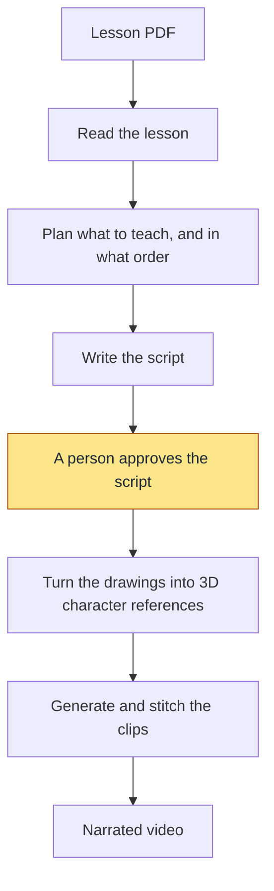

# Chalkline

**AI lesson videos for a primary school, with seven points where a person must approve. And the audit that showed what both quality checks were missing.**

This repo is the case study. The code stays private. The full story is on my site: [arunbhisne.com/projects/chalkline](https://www.arunbhisne.com/projects/chalkline)

| | |
|---|---|
| **The school** | A private English-medium school in India, unnamed by agreement. Pro bono. |
| **The job** | Turning textbook lessons into short narrated videos for children aged 4 to 10 |
| **My role** | Every architecture, evaluation, product and budget decision. I never opened a code editor. |
| **The system** | Twelve stages, seven where a person must approve before it continues |
| **Today** | In use at the school |

## How it works

A lesson PDF goes in and a narrated 3D video comes out. Agents read the lesson, plan what to teach and in what order, write the script, turn the textbook's flat drawings into 3D character references, then generate and stitch the clips.

*Simplified. The real pipeline has twelve stages and seven approval points, placed before the expensive video step.*

## What the audit found

I audited one finished run end to end, against its lesson. The system had read the lesson correctly, then made a video with none of it in.

| | |
|---|---|
| Lesson exercises the first stage found and tagged | 7 of 7 |
| Lesson exercises that reached the finished video | 0 of 7 |
| Beats of the video spent retelling the poem | 11 of 12 |
| Time the human approval took to let it through | 70 seconds |

My automated critic approved it after a full redraft cycle. The human gate approved it too. Neither was holding a list of what the lesson contained, so neither could see what was missing. I had been treating "a person approved it" as proof. It proves nothing without something to check against.

## Decisions I made

**1. I benchmarked against a video I made by hand, not against a rubric.**
I built one video myself, shot by shot, and made it the answer key: 8 shots, each with timestamped blocks, named fields and audio tracks. The live system was producing 28 to 31 flat shots with none of that structure. A rubric would have scored it fine. It was a structural gap, not a polish gap.

**2. I banned silent dropping.**
Every activity in the lesson must now either be given a place in the video or be marked with a reason for skipping it. A dropped activity becomes something you can see in the log instead of something nobody notices.

**3. I split coverage from craft.**
A critic called "quality" had quietly narrowed to mean narrative quality, and about the narrative it was right every time. So I specified a second critic that checks one thing: did every concept get taught. Two separate checks, never one blended score.

**4. I cut the one feature I couldn't govern.**
Lip-sync came out, taking the pipeline from 13 stages to 12. Narration now runs as a separate voiceover, which is cheaper and gives me control of the script and pronunciation. Spend is checked against a cap before calls go out: the audited run spent $0.58 against a $5 cap (stages 1 to 6).

**5. I spent AI decision-making only where it helped.**
With every step agentic and gated, the first phase was projected at about 18 to 20 lakh rupees. Once the early steps were tight, the video step could run almost by rule. That cut the projected cost to about 1 lakh. Adding agency is the default move. Removing it is the senior move.

## What this does not claim

- **One lesson, one audit.** No repeat runs and no test suite behind these numbers.
- **No before and after.** There is no baseline for what a lesson video cost the school before, so there is no saving to quote.
- **The coverage fix is a specification.** I found the failure, specified the fix and made it the top priority. A fix is not a result, so I'm not presenting it as one.
- The cost figures in decision 5 are projections. Every other figure here is measured.

## About the code

The code stays private. If you want to see how it was built, I'm happy to walk you through it on a call: the specs, the decisions and the audit.

---

**Arun Bhisne** · AI Solutions Designer-Builder · [arunbhisne.com](https://www.arunbhisne.com) · [LinkedIn](https://www.linkedin.com/in/arunbhisne)
